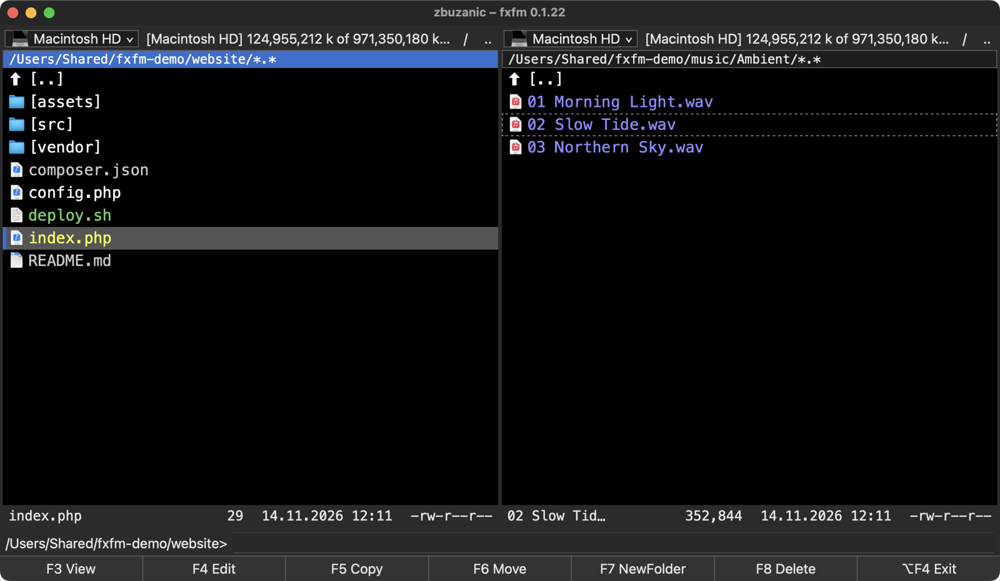
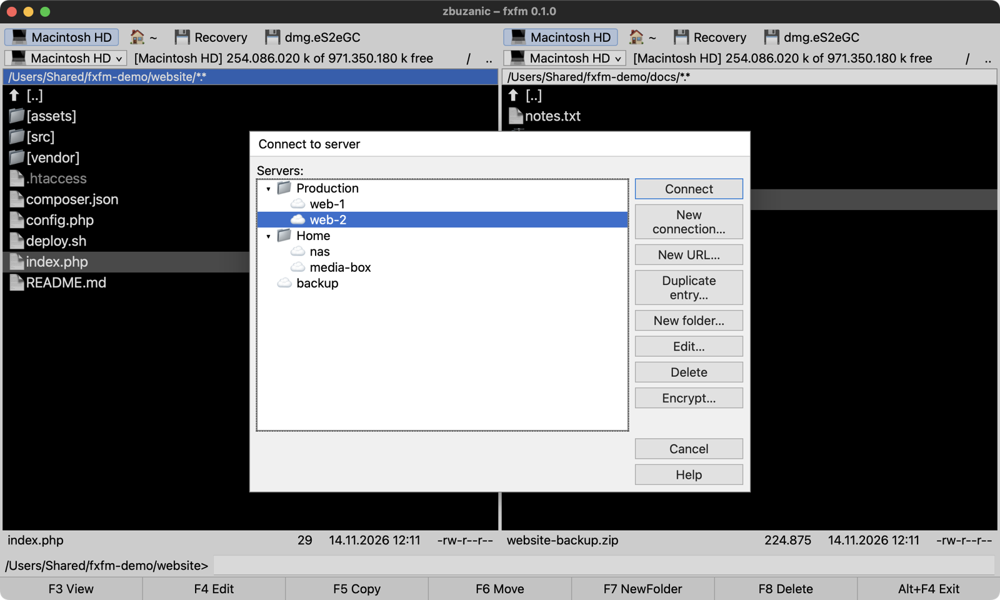

# fxfm

A Total Commander-style dual-panel file manager for macOS: two panels, TC's keys
(F3–F8, Tab, Ctrl+D…) and its way of working, on local disks, inside archives
and on servers. One universal app for Apple Silicon and Intel Macs, macOS 15 or later.

| F3 plays audio in place | Ctrl+F: servers |
| --- | --- |
|  |  |

## What it can do

- **Two panels, the TC way**: copy (F5), move (F6), new folder (F7), delete to
  the Trash (F8), rename in place (F2), mark with Space/Insert, quick search
  (Cmd+letters), a command line, a directory hotlist (Ctrl+D), the drive menu
  (Alt+F1/F2). Every key can be changed, and Option, Control or Command can play
  TC's Alt and Ctrl.
- **Archives as folders**: ZIP, 7z and TAR (also .tar.gz, .tar.bz2, .tar.xz)
  open like folders, even inside each other; copy in and out, edit, delete and
  rename inside them. Pack files into a new archive (Alt+F5), a ZIP also with a
  password.
- **Servers**: SFTP, SCP, FTP and FTPS in a panel like a local folder, and SMB
  network shares mounted as drives. Saved connections in groups, passwords in
  the macOS Keychain (or encrypted with a master password in portable mode).
  Files from a server open in your editor (F4) and go back when saved.
- **Find files** (Alt+F7) in its own window, over an index of the disk that
  stays current, or by **text inside files** in a folder; results sort by any
  column and can be copied, moved, deleted or dragged.
- **Synchronize dirs**: compare two folders (local, archive or server), see
  what differs on each side, and copy or delete in the chosen directions
  (two-way, mirror, update).
- **Undo** (Ctrl+Z) of the last move, rename, new folder or Trash delete.
- **Quick filter** (Ctrl+S), folder history (Alt+←/→), **branch view** (Ctrl+B:
  every file below a folder in one list), **multi-rename** (Ctrl+M) with a preview.
- **F3 viewer**: text, hex, images and PDF in a window of their own; audio
  (WAV, MP3, FLAC, OGG, Opus, M4A, AIFF) plays in place, with a player strip.
- **Fits into macOS**: drag & drop with Finder and other apps, Copy/Cut/Paste
  that work with Finder, Quick Look, Open with, Show in Finder, Finder's own
  icons, dark mode. A right-click menu with the common actions, and for files on
  an SMB share a Windows (`\\server\share\…`) or `smb://` path to send to others.
- **Your look**: panel colors by file type, a choice of fixed-pitch fonts and
  icon styles, and what the window shows (command line, key bar, drive bar).
- **Portable**: put an `fxfm-data` folder next to the app (e.g. on a USB stick)
  and it carries its own settings and saved servers.

## Download

Builds are on the [Releases](https://github.com/fx02/fxfm/releases) page.
Installation, every feature and the full key list: [docs/MANUAL.md](docs/MANUAL.md).
