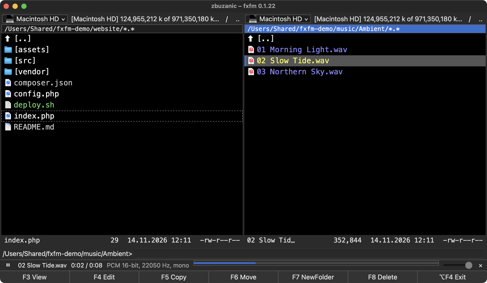

# fxfm

fxfm is a Total Commander-style dual-panel file manager for macOS (Rust + Tauri 2). The keys are TC's (F3–F8, Tab, Ctrl+D…; by default TC's Ctrl is the Mac **Control** key and TC's Alt is **Option**, and Configuration → Keyboard can make Command either of them, see "Alt and Ctrl keys"), and the menu lives in the macOS menu bar (Files, Mark, Commands, Net, Show, Configuration, Start, Help). It works with local disks, archives (as folders) and servers (SFTP, SCP, FTP, FTPS).

Requires macOS 15 (Sequoia) or later.


| F3 plays audio in place | Ctrl+F: servers |
| --- | --- |
|  |  |

## Build

You need Rust (the toolchain from `rust-toolchain.toml`, with the `aarch64-apple-darwin` and `x86_64-apple-darwin` targets) and `tauri-cli` 2 (`cargo install tauri-cli --version "^2"`).

```sh
rustup target add aarch64-apple-darwin x86_64-apple-darwin
cargo tauri build --target universal-apple-darwin
```

Output (universal, runs on Apple Silicon and Intel Macs):

- app: `target/universal-apple-darwin/release/bundle/macos/fxfm.app`
- disk image: `target/universal-apple-darwin/release/bundle/dmg/fxfm_<version>_universal.dmg`

If the `.dmg` step crashes with "Finder is busy" (locked screen, SSH), run the build with `CI=true`: this skips Finder's DMG layout customization.

A plain `cargo tauri build` signs the app ad hoc (`signingIdentity` is `-` in `tauri.conf.json`). `scripts/build-macos.sh` builds with the maintainer's stable local identity "fxfm local signing" instead (kept in `~/.fxfm-signing/`, not in the repo): it unlocks that keychain, sets `APPLE_SIGNING_IDENTITY`, runs the universal build and verifies the signature and architectures. With a stable identity macOS remembers the granted folder access between builds; with an ad hoc signature it asks again after each rebuild.

Check: `lipo -archs target/universal-apple-darwin/release/bundle/macos/fxfm.app/Contents/MacOS/fxfm` prints `x86_64 arm64`.

Tests: `cargo test --workspace`, `cargo clippy --workspace --all-targets -- -D warnings` and `node --test ui/`.

## Where the data lives

Settings are four JSON files: `settings.json`, `session.json`, `keymap.json` and `hotlist.json`. They can be edited by hand (while fxfm is not running).

- **Portable**: an `fxfm-data/` folder next to `fxfm.app`, if it exists and is writable.
- **System** (otherwise): `~/Library/Application Support/fxfm/`.

The mode is changed in Configuration → Options → Storage (Apply). fxfm then copies all settings to the new location. When switching from portable to system, the old folder stays as `fxfm-data.old`.

## Portable setup

Create a folder, e.g. on a USB drive:

```
fxfm/
├── fxfm.app
└── fxfm-data/      (empty folder)
```

On first launch fxfm detects `fxfm-data/` and stores everything there; the system folder is left alone.

## Moving to another Mac

Copy the whole `fxfm/` folder (USB, network, zip). macOS adds a *quarantine* attribute to the copied app. Because of this, Gatekeeper may block it, and *App Translocation* runs it from a random read-only path, where `fxfm-data/` is not visible.

fxfm detects this and offers:

- **Fix and restart**: removes the quarantine attribute and relaunches from the real location, with the settings from `fxfm-data/`;
- **Continue without settings**: keeps running, but without the portable settings, and the session (panels) is not saved.

The same by hand, in Terminal, before the first launch:

```sh
xattr -dr com.apple.quarantine /path/to/fxfm/fxfm.app
```

The app is signed with a local identity but not notarized (personal use). If Gatekeeper still rejects it, the simplest fix is to run the `xattr -dr com.apple.quarantine …` command above. Alternatively, try to open fxfm, then click "Open Anyway" in System Settings → Privacy & Security (on macOS 15, right-click → Open no longer bypasses Gatekeeper).

## Archives

Archives open as folders. Supported formats: `.zip`, `.tar`, `.tgz` / `.tar.gz`, `.tbz2` / `.tar.bz2`, `.txz` / `.tar.xz`, `.gz` (only if it contains exactly one file) and `.7z`. Other formats (a lone `.bz2` or `.xz`, rar) are opened by Enter with the default application.

- **Entering and leaving**: Enter on an archive enters it (archives on a server: see "Servers"); `[..]` at the archive root returns to the folder with the cursor on the archive.
- **Archives inside archives** (`outer.zip/inner.tar.gz/dir`) open as folders too, at any depth, and everything below works in them as in any archive. The inner archive is taken out to a temporary file (reused while the outer archive is unchanged); after each change it is written back into the outer archive, one atomic rewrite per level. If writing back fails, the outer archive stays as it was and the inner one is read again from it. A password-protected inner archive asks for its own password.
- **Working inside an archive**: F3, F4, F5 and F6 (into and out of the archive), F7, F8 and F2. Shift+F4 is not available inside.
- **F8** deletes permanently: "Delete N file(s) from archive? This cannot be undone."
- **Copying into an archive** works like a local copy: a folder merges into an existing folder of the same name without a question, and every file that already exists gets the overwrite question (Overwrite / Overwrite all / Overwrite all older / Skip / Skip all / Rename). The same holds for moving inside one archive.
- **Password**: for a password-protected zip, fxfm asks for it when the file is opened or extracted; a wrong password asks again.
- **F4 (edit)**: the file is edited as a copy in a temporary folder. After each save fxfm asks `"<name>" was changed. Upload it back into the archive?`. If the entry in the archive changed in the meantime, it asks once more before overwriting.
- **Unuploaded changes**: copies that were not uploaded back survive Cmd+Q and crashes. On the next launch fxfm lists them ("Edited copies from a previous session were not uploaded:"): **Show in Finder** opens them, **Keep** (default, and Esc) leaves them so the dialog shows up again on the next launch, and **Discard**, after confirmation ("Move these copies to the Trash?"), moves the copies to the Trash.
- **Writing**: every change writes a temporary archive next to the original, which replaces it only if everything succeeded. **7z** is fully repacked in the process (slower, needs free space next to the archive, the result is not solid).
- **Refusals**: encrypted archives are not modified; encrypted 7z cannot be read; 7z with unsafe entry names is not overwritten; a tar in which a hard link points to an entry being deleted or renamed is not modified; `.gz` has its own limitation (a single file).
- **Temporary files**: `~/Library/Caches/fxfm/tmp/<pid>/`. They are deleted on exit, except for unuploaded changes.

## Pack files (Alt+F5)

**Alt+F5** (Option+F5 with the default keys; Files → Pack files…) packs the marked entries of the active panel, or the entry under the cursor, into an archive: **ZIP**, **TAR**, **TAR.GZ** (`.tgz`), **TAR.BZ2**, **TAR.XZ**, **7Z**, or **GZ** for a single file. The *Format* list renames the target, and typing a name with another suffix picks its format. Folders go in with everything below them (empty folders and hidden files too); symbolic links are stored as links, and modification times and Unix permissions are kept. Names are stored as UTF-8.

- **Name and place**: one entry gives its name without the last extension (`report.pdf` → `report.zip`, folder `site` → `site.zip`, `.config` → `.config.zip`); several entries give the name of their folder (`web.zip`), or `archive.zip` at the root. Like in TC, the archive goes to the other panel's folder when that is a local folder, otherwise to the active panel's folder. The dialog shows the full path and lets you change it.
- **Password**: *Encrypt with a password* asks for the password twice and the method: **AES-256** (default, secure) or **ZipCrypto** (weak, but opens everywhere). Finder's Archive Utility cannot open AES-256 zips; fxfm, Keka and 7-Zip can. The password is not saved or logged, and is cleared from fxfm's memory (the Rust side) when the job ends.
- **Times**: entries carry the local time in the zip's DOS field plus the UTC time in the Info-ZIP extended timestamp, so Finder, `unzip`, 7-Zip, Keka and fxfm show the same times. fxfm reads that timestamp when present, else the DOS field as local time (also for zips from other tools).
- **Not into itself**: an archive cannot be packed onto its own name, nor into a folder being packed ("Cannot pack an archive into itself").
- **Writing**: a new archive is written to a hidden `.<name>.fxfm-<pid>-<n>.part` next to the target and renamed into place at the end; Cancel or an error removes the `.part`. An existing archive of the same name is only replaced after "`<name>` already exists." → **Overwrite**. Unreadable files ask Retry / Skip / Skip all / Cancel, as in a copy.
- **Formats**: only ZIP can be encrypted. TAR, TAR.GZ and 7Z are made through fxfm's archive writer (a 7z is compressed in one pass at the end, so it is slower). A GZ holds exactly one file and keeps its whole name (`report.pdf.gz`).
- **Adding to an archive**: when the target exists, the question also offers **Add to archive** (not for GZ or with a password): the items go into it, replacing entries of the same name.
- **Archives and servers**: items inside an archive or on a server are copied to a temporary folder first, and an archive whose folder is inside an archive or on a server is made in a temporary folder and then copied there (the other panel's folder is the default, as in TC). Temporary folders are removed afterwards. *Add to archive* works for archives in local folders.

## Search (Alt+F7)

**Alt+F7** (Option+F7 with the default keys; Commands → Search) opens *Find files* in its own window, which can be moved, resized, maximized or made full screen like any macOS window (also on another screen); Alt+F7 again brings it to the front and takes the active panel's folder as *Current folder*. It searches by **name** only (not file contents), with words (all must match) and masks (`*`, `?`), and shows results while you type. Folders match too. Searching on SFTP/SCP/FTP servers is not supported.

- **Where**: *Everywhere* uses fxfm's own **index**; *Current folder* walks the active panel's folder directly (also used until an index exists, or when the index is off).
- **What is indexed**: the startup disk, including hidden files and `~/Library`. Skipped as system internals: `/System`, `/private/var`, `/private/tmp`, `/dev`, `/Volumes` (other volumes are separate), `/cores`, `.Spotlight-V100`, `.fseventsd`, `.Trashes`, `.DocumentRevisions-V100` and Time Machine snapshots. More folders can be excluded in Options. Other local volumes are indexed when enabled in Options and are kept current by FSEvents; fxfm also replays what changed while it was closed.
- **First run**: nothing is indexed silently. The first Alt+F7 explains it and offers *Open Privacy settings*, *Build index* and *Not now* (*Not now* searches the current folder). Both stay at the bottom of the Find files window: *Build index* (*Rebuild index* once it exists) and *Open Privacy settings*. Without **Full Disk Access** macOS may ask once per protected folder (Desktop, Documents, Downloads, removable and network volumes); refused folders are skipped, listed in Options → Search, and can be retried after access is granted.
- **Inside archives**: off by default. When *Index files inside archives* is on (Options → Search), the entries of zip, 7z, tar, tar.gz/tgz, tar.bz2, tar.xz and gz files are indexed (compressed tars and gz above a size limit, default 500 MB, are skipped) and the Find files window gets an *Inside archives* checkbox. A result shows as `archive ▸ inner path`. Archives are re-read only when their size or date changes; cloud-only placeholders (iCloud, Dropbox, OneDrive) are never opened, so nothing is downloaded; nested archives are not entered.
- **Network volumes** (SMB, AFP, NFS, WebDAV): each is enabled by hand in Options. They have no live updates: they are rescanned every N hours (default 24, 0 = only by hand) while mounted, or with *Refresh now*. An unmounted volume keeps its last index ("last refreshed <date>"); picking one of its results asks to mount it. Archives on network volumes are read only if that option is on.
- **Keys in the window**: Enter goes to the file (the active panel of the main window opens its folder, cursor on it, and the main window comes to the front); F3 views it; Esc (or Ctrl+W, or the red button) closes. Closing fxfm closes it too. A result whose file has disappeared is greyed; picking it says it no longer exists and drops it from the index.
- **The result list**: Name, Folder, Size and Date columns; drag a header edge to resize a column, right-click the header to hide or show Folder, Size and Date. A cut-off name or folder shows in full in its tooltip (otherwise the tooltip is the full path). The window's position, size, maximized state and the columns are kept for the next time. Cmd+click (or Control+click) adds or removes a result from the selection, Shift+click and Shift+Up/Down select a range.
- **Feed to listbox** (Ctrl+Enter, or the button; with several results selected only those go, otherwise all; also Commands → Feed search results to listbox): the results become a "Search results: <query>" list in the active panel. On marked items or the cursor item: **F3**, **F4**, **F5** / **F6** (copy or move into the other panel's folder, all into that one folder; name clashes use the usual conflict dialog), **F8**, and drag & drop out (local files). **Ctrl+PgUp** or **Enter** on a row goes to the item's folder with the cursor on it; **Backspace** or `..` returns to the folder the panel was in before. Entries inside archives allow only F3 and F5 (extract).
- **Options → Search** (always the last section of Options): *Index while fxfm is running* (turning it off asks first and deletes the index file), the volumes with on/off, state, entry count and *Refresh now*, excluded folders, archive indexing with the gz limit and the network-archives switch, the network refresh interval, folders macOS refused (*Retry*, and the Full Disk Access hint), and *Rebuild index*.
- **Where the index lives**: in the data folder, as `index/index.bin`: `~/Library/Application Support/fxfm/index/` in system mode, `fxfm-data/index/` in portable mode (it can be large: budget up to about 300 MB for 3 million entries). An unreadable or old index is rebuilt.

## Quick search (Cmd+letters)

In the active panel, Command+letter jumps to the first entry whose name starts with that letter (TC's Alt+letters); more letters typed with Command narrow it (Cmd+F, Cmd+X → first name starting with "fx"). A small box over the status line shows the typed text; a letter that matches nothing is not added. Up/Down go to the previous/next match, Backspace drops a letter, Esc or a 3-second pause closes the box, and any other key closes it and works as usual (Enter opens the found entry). Cmd+Q and Cmd+H stay with macOS, and a key bound in Configuration → Keyboard keeps its command. The keys are set in Configuration → Keyboard → *Quick search*: Command+letters (default), Control+Command+letters, Option+letters, letters alone, or off.

## Multi-rename (Ctrl+M)

**Ctrl+M** (Files → Multi-rename) renames the marked items (or the one under the cursor) in a local folder or in a search results list. The new names come from masks with a live preview of old and new names:

- **Name** and **Ext** masks: `[N]` the name without extension, `[N2-5]` its characters 2 to 5, `[N3]` one character, `[N3-]` from the 3rd on, `[E]` the extension (also `[E1-2]`), `[C]` the counter, `[P]` the folder's name, `[Y]` `[M]` `[D]` `[h]` `[m]` `[s]` the modification date and time, `[[` a literal `[`. An empty Ext mask drops the extension.
- **Search / Replace** on the whole new name: plain text (case-insensitive unless *Match case*) or a *Regular expression* (`$1` in the replacement).
- **Case**: unchanged, lowercase, UPPERCASE, first letter, first letter of each word.
- **Counter** `[C]`: start, step and digits (zero-padded); *per folder* starts it again in each folder (useful in a search results list).
- **Names from file…**: a text file with one new name per line gives the names in the list's order (the masks are off; search/replace and case still apply; rows past the end of the file keep their names). *Use masks* goes back.
- **Presets**: *Save…* keeps the current options under a name (in the settings); picking a preset fills the dialog, *Delete* removes it.

Names that would clash (two items with one name, or a name that another file already has) are shown in red and Start stays disabled; nothing is ever overwritten. Swapping and shifting names inside the batch works (each item goes through a temporary name), and so do case-only changes. *Undo last rename* in the dialog gives the items of the last multi-rename their old names back. The options are kept until fxfm quits.

## Alt and Ctrl keys

Configuration → Keyboard chooses which Mac key acts as TC's **Alt** (default **Option**) and which as TC's **Ctrl** (default **Control**); either can be Option, Control, Command or Fn, but not the same key for both. The key table and `keymap.json` stay in TC terms (`Alt+F5`, `Ctrl+D`), so changing the keys does not change the bindings; the menus, Configuration → Keyboard and the F-key bar show the Mac keys in use (`⌥F5`, or `⌘F5` with Command as Alt). A Mac key chosen for Alt or Ctrl no longer gives `Cmd+` combos, and an unchosen Control or Option key gives no command. Command+Q and Command+H (Quit and Hide in the fxfm menu, also Option+Command+H) stay with macOS whatever is chosen, and in text fields Command+A, C, V, X and Z keep editing the text. **Fn** (globe) can be chosen too: WebKit does not tell the page whether Fn is held, so fxfm watches the Fn key itself; the labels then read `fn F5`. On keyboards where the F-keys need Fn, Fn+F5 then means Alt+F5 (or Ctrl+F5), so switch the F-keys to standard function keys in System Settings → Keyboard, and Fn shortcuts macOS uses itself (Fn+E, Fn+F, Fn+Q…) stay with macOS. Open F3 viewer windows take a change at once.

## Servers

**Ctrl+F** (Net → Connect to server) opens the server list: a tree of folders and servers, with the buttons *New connection…* and *New URL…*. Protocols: **SFTP**, **SCP** (default port 22), **FTP** and **FTPS** (21), and **SMB** network shares (445, see below). *New URL…* connects once, without saving, e.g. `sftp://user@host:2222/var/www`; FTP without a user logs in as anonymous.

- **Location** is `<protocol>://<server name>/<path>`, e.g. `sftp://web-1/var/www/html`. The server name must be unique across the whole list. Connected servers appear as drives in the bar above the panels (☁️ name), and their address is in the header. Every saved server is also listed in the drive menu (**Alt+F1 / Alt+F2**, ☁️ name, after the drives and shares, in the order of the server list): picking a connected one goes to the other panel's folder when it is on that server, else to the last folder visited there, else to the root; picking one that is not connected connects it and opens it in that panel. The hotlist accepts the same locations (`cd sftp://<name>/var/www` on the command line connects and opens).
- **Authentication**: password, key, or key + passphrase. A private key is picked from disk or imported (*Import…*): the copy goes to `keys/` in the data folder, with permissions 0600. Per-server options: a local folder that opens in the OTHER panel after connecting, filename encoding on FTP (UTF-8, Windows-1250, Latin-1), older SSH algorithms, FTP active/passive mode.
- **Host key**: on first connection fxfm shows the server's key fingerprint (the certificate for FTPS); accepted ones are remembered in `known_hosts` in the data folder. A changed key is not silently accepted: the dialog offers *Replace and connect* or Cancel.
- **Passwords** never go into `servers.json`.
  - *System mode*: macOS Keychain, service `fxfm`, account `<server id>/password` or `<server id>/passphrase`.
  - *Portable mode*: `secrets.json` in `fxfm-data/`, encrypted with a **master password** (Argon2id 64 MiB, XChaCha20-Poly1305). The master password is asked for once per launch, when needed, and is kept in memory only. Without it, passwords are not saved (a password that was entered but not saved is valid until exit, so reconnecting works).
- **Operations**: F3, F4, F5, F6, F7, F8 and F2 also work on a server, as does **chmod** (Files → Change attributes…, no default key; SFTP and SCP, and local files, not inside archives). F8 deletes permanently: "Delete N file(s) from the server? This cannot be undone.". An upload writes to a temporary `.<name>.fxfm-<pid>-<n>.part` next to the target and then replaces it, so an interruption never leaves a truncated original; on SFTP and SCP the existing file's permissions are kept (FTP and FTPS do not set permissions).
- **Symbolic links**: Enter on a link to a folder enters the folder, and F8 deletes only the link. Some FTP servers show a link to a folder as a plain folder; there, F8 on it deletes the contents of the target folder.
- **F4** on a file on a server edits a temporary copy; after saving, fxfm asks `"<name>" was changed. Upload it back to the server?`.
- **Archives on a server**: Enter on an archive downloads it as an F4 copy and enters it. Changes inside (F5, F8, F2…) modify the copy, so fxfm offers to upload it back to the server. `[..]` at the archive root returns to the folder on the server.
- **Ctrl+Shift+F** (Net → Disconnect) closes the active panel's connection; panels on that server go to the server's local folder or to home. Temporary copies of that server's files (without unuploaded changes) are deleted.
- **Connection lost**: connecting takes at most 15 s (*Cancel* in the "Connecting to …" note stops it at once; a connection that completes afterwards is closed), and a transfer or request with no progress 60 s; SSH sends a keepalive every 30 s, and FTP sends `NOOP` after 30 s of inactivity. A dead connection is reported with the dialog `Connection to <name> lost` with the buttons **Reconnect** (the panels re-list their folders) and **Close**.
- **Data**: `servers.json` (the tree, no passwords), `known_hosts`, `keys/` and (portable) `secrets.json`, in the data folder.

### SMB network shares

A connection of the protocol **SMB (network share)** is a mapped network drive. Its fields are the host (*Browse…* lists the computers that announce file sharing on the local network over Bonjour, and Windows file servers found over NetBIOS, shown with their address), the port (445 is left out of the URL), the **share** (*Shares…* asks the server for its shares with the entered user and lets you pick one), the user and an optional **folder in the share** that opens after connecting. An empty user logs in as guest; a Windows domain is typed as `DOMAIN\user` or `DOMAIN;user` (if the server rejects that, the mount is tried once more with the domain and user only in the URL).

- fxfm does not speak SMB itself: **macOS mounts the share** (NetFS, the same as Finder's *Connect to Server*) under `/Volumes`, and the panel opens the mount point as an ordinary local folder, so every command works there as on a local disk.
- *Connect* (Ctrl+F) mounts the share if it is not mounted yet and opens `<mount point>/<folder in the share>`. A share that is already mounted (also by Finder) is used as it is, without a new mount or a password. While macOS mounts it, *Cancel* stops waiting (the mount may still finish in the background).
- The password comes from the Keychain or the portable vault like any server password; without a saved one fxfm asks (with *Save password*). It is passed to macOS separately, never in the URL. A rejected login asks again with "Wrong user name or password.".
- **Kerberos**: *Use the Kerberos ticket* mounts with the system's ticket (from `kinit` or Ticket Viewer) instead of a password; fxfm never asks for or stores one for such an entry, and the user field is optional. Without a valid ticket the mount fails with a message saying so.
- *Shares…* runs `smbutil view`. Its password never appears on a command line: smbutil reads it only from a terminal, so fxfm runs it on a pseudo-terminal of its own and types the password there.
- **Connect at startup**: a share with this option (in its connection settings) is mounted when fxfm starts, with its saved password; fxfm never asks at startup, and a share it could not mount is named in the status line.
- **Every saved share is a drive**: it is listed after the volumes in the drive menu (Alt+F1 / Alt+F2) and the drive bar (🌐 name), in the order of the server list. A mounted share is shown once, under its name, with its free space; picking an unmounted one mounts it. A share mounted under another name of the same server (an IP address or an alias that resolves to the same address) counts as mounted.
- **Disconnect**: the button in Ctrl+F for a mounted share, **Ctrl+Shift+F** while the active panel is on it, or **Delete** on it in the drive menu, runs `diskutil unmount` (never forced). If a file on the share is still open, diskutil's message is shown and the share stays mounted. Panels on the share go to the home folder.

## F3 audio preview

F3 on an audio file plays it immediately, in the main window; focus stays in the panel. The bar above the F-keys shows the name, `m:ss / m:ss` and the codec; clicking the bar seeks to that position. The ⏸ button pauses and ▶ goes on from the same place; the slider sets the volume (kept for the next start). F3 on the same file or Esc stops it. It also works in archives and on servers. Formats: wav (PCM, float, A-law, μ-law, ADPCM, GSM 6.10), mp3, flac, ogg, opus, m4a, aiff.

The output device is chosen in Options → Audio → *Output device* (default *System default*); a change takes effect immediately, including for what is currently playing. If the chosen device is not connected, playback uses the default one, and the bar reports it once.

## Colors

Configuration → Options → *Colors* works like TC's Configuration → Color page: font color, background, *Background 2* (every second row; the same as the background means no striping), mark color, cursor color and cursor font (*use the file's color* keeps the entry's own color on the cursor bar). *Use inverted cursor* draws the cursor as a filled bar; without it the cursor is a frame in the cursor color. In the inactive panel the cursor is always only a dashed frame. The *Example* box shows the choice before it is saved; OK applies it at once, *Reset to defaults* restores the defaults.

*Define colors by file type* (TC's dialog of the same name) colors files and folders by an ordered list of rules: TC masks (`*.zip;*.7z`, separated by `;` or spaces, `*` and `?`, any case) and a color; the first matching rule wins. Add…, Edit… (also Enter, Space or a double click), Delete, Move up / Move down (also Ctrl+Up / Ctrl+Down or dragging a row). The defaults: text and documents light grey, executables green, images yellow, archives red, video and audio blue. Precedence in a row: marked entries in the mark color (also on the cursor bar), then the cursor font on the cursor bar, then the first matching rule, then the hidden-file color, then the font color. Settings from older versions keep their custom colors (the old archive and video/audio colors go to those rules).

## Drag & drop

- **Out**: dragging the selected items (or the row under the pointer) from a panel into other applications, e.g. Finder. Local files follow the receiver's rules: Finder moves them on the same disk and copies them to another one (Option copies, Command moves), and the panel refreshes after a move. Items inside archives and on servers (SFTP/SCP/FTP/FTPS) are always copied: they are extracted or downloaded only when the receiver asks for them, straight to the place it names (folders with everything in them); an item that already exists there is not overwritten, and errors show in the status bar. With more than one item the drag image shows their number.
- **In**: from Finder into a panel.
- **Between panels**: dropping opens the F5 dialog with the target = the folder under the pointer or the panel's folder. **Shift** while dropping gives F6 (move). The dialog also has a *Move instead* / *Copy instead* button, in case you miss Shift.

## Right-click menu and clipboard

- **Right click** on a row (or **Shift+F10** on the cursor row) opens a menu: *Open*, *Copy name*, *Copy path*, *Cut*, *Copy*, *Paste*, *Delete* (Trash), *Rename*. It acts on the marked items when the clicked row is marked, otherwise only on that row (other marks are cleared, as in Finder). On empty space or `..` it offers only *Paste*.
- **Copy / Cut** put the items on the macOS clipboard (local files as files, so Finder's Paste copies them; everything also as text). **Paste** copies (or, after Cut, moves) them into the panel's folder without the F5 dialog; existing files are asked about as in F5. Files copied in Finder paste into a panel too. Items in archives and on servers paste only inside fxfm.
- *Copy name* / *Copy path* put the names or full paths (one per line) on the clipboard as text. All of these are also commands without default keys (Files and Mark menus) and can get keys in Configuration → Keyboard.

## Notes

- **Icons**: Configuration → Options → View → *Icons* chooses the row icons: *Finder* (default) uses the icons macOS shows in Finder — the folder icon, each file type's icon and an application's own icon — and *Emoji* the older emoji icons.
- **What the window shows**: Configuration → Options → View turns on or off the command line, the function key bar, the drive button bar (off by default; the drive dropdown and Alt+F1 / Alt+F2 stay), each panel's header (drive dropdown, free space, path) and each panel's status line. With all of them off only the file lists are left; Alt+F1 / Alt+F2 then opens the drive menu at the panel's corner, and quick search still shows its box while typing.
- **Trash (F8)**: fxfm moves items to the Trash via `NSFileManager`, not via Finder. It is faster and does not need Automation permission, but Finder's "Put Back" does not work for items deleted by fxfm.
- **PDF in the F3 viewer**: the PDF is shown in an iframe via the asset protocol, with an "Open in Quick Look" button always visible next to it. Whether WKWebView really renders the PDF in the iframe has not yet been checked by hand; if not, Quick Look is the fallback.
- **Full Disk Access**: for some folders (Mail, Messages, Safari…) you need to enable fxfm in System Settings → Privacy & Security → Full Disk Access. fxfm explains this the first time it hits a denial.
- **Keys macOS takes**: Control+arrows (Mission Control, Spaces) and Control+Space (input source) are intercepted by macOS before fxfm. Configuration → Keyboard warns if a binding lands on such keys with the Alt/Ctrl keys in use and offers to open System Settings → Keyboard → Keyboard Shortcuts.
- With the default keys Command is not used for TC commands; the exceptions are Cmd+Q and the standard Edit menu (Cmd+C/V/X/A in text fields). See "Alt and Ctrl keys" for Command as Alt or Ctrl.

## Default keys

The table is generated from the command registry (`COMMANDS` in `crates/core/src/keymap.rs`); the test `readme_key_table_matches_commands` fails if it goes stale and prints the new one. Keys are changed in Configuration → Keyboard ("Reset to TC defaults" restores these). The table is in TC terms: Alt and Ctrl are the Mac keys chosen for them (by default Option and Control). When fxfm gains a command, its default keys are added to an existing `keymap.json` once at startup, unless another command already uses them (`keymapCommands` in `settings.json` records which commands the keymap has seen, so a key you removed is not added back).

<!-- keys:start -->
| Menu | Command | Keys |
|---|---|---|
| Files | View | `F3` |
| Files | Edit | `F4` |
| Files | Edit new file | `Shift+F4` |
| Files | Copy | `F5` |
| Files | Move | `F6` |
| Files | Pack files… | `Alt+F5` |
| Files | Rename | `F2`, `Shift+F6` |
| Files | New folder | `F7` |
| Files | Delete | `F8`, `Delete` |
| Files | Delete permanently | `Shift+F8`, `Shift+Delete` |
| Files | Exit | `Alt+F4` |
| Mark | Mark/unmark | `Space`, `Insert` |
| Mark | Select group | `NumAdd`, `Ctrl+=` |
| Mark | Unselect group | `NumSubtract`, `Ctrl+-` |
| Mark | Invert selection | `NumMultiply`, `Ctrl+8` |
| Mark | Select all | `Ctrl+A` |
| Mark | Copy names to clipboard | — |
| Mark | Copy names with path to clipboard | — |
| Commands | Switch panel | `Tab` |
| Commands | Directory hotlist | `Ctrl+D` |
| Commands | Parent directory | `Backspace`, `Ctrl+PageUp` |
| Commands | Root directory | `Ctrl+\` |
| Commands | Swap panels | `Ctrl+U` |
| Commands | Target = Source | — |
| Commands | Search | `Alt+F7` |
| Commands | Feed search results to listbox | — |
| Files | Multi-rename… | `Ctrl+M` |
| Files | Context menu | `Shift+F10` |
| Files | Cut to clipboard | — |
| Files | Copy to clipboard | — |
| Files | Paste from clipboard | — |
| Files | Change attributes… | — |
| Net | Connect to server | `Ctrl+F` |
| Net | Disconnect | `Ctrl+Shift+F` |
| Show | Left drive | `Alt+F1` |
| Show | Right drive | `Alt+F2` |
| Show | Refresh | `Ctrl+R` |
| Show | Show hidden files | `F1`, `Ctrl+H` |
| Commands | Command line | `Ctrl+Enter` |
| Configuration | Keyboard… | — |
| Configuration | Options… | — |
<!-- keys:end -->

Fixed keys in a panel (not remappable): Up/Down, PageUp/PageDown, Home/End, **Left = first visible row in the window**, **Right = last visible row in the window**; if the cursor is already there, the next press moves by a whole window (the first row of the previous window, or the last row of the next one), Enter.
